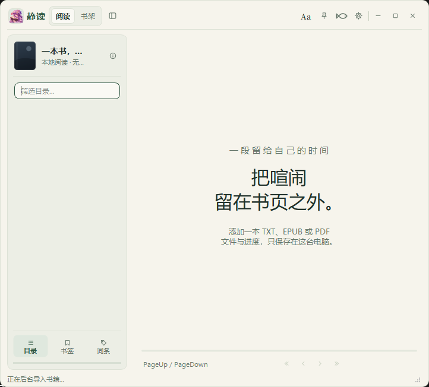
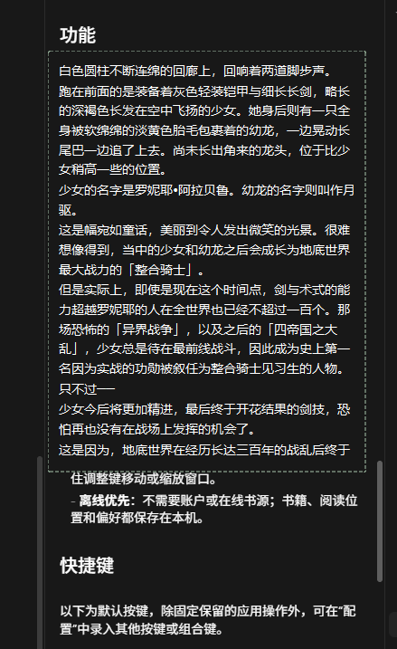
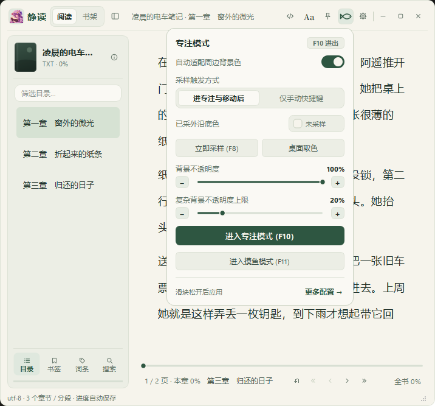
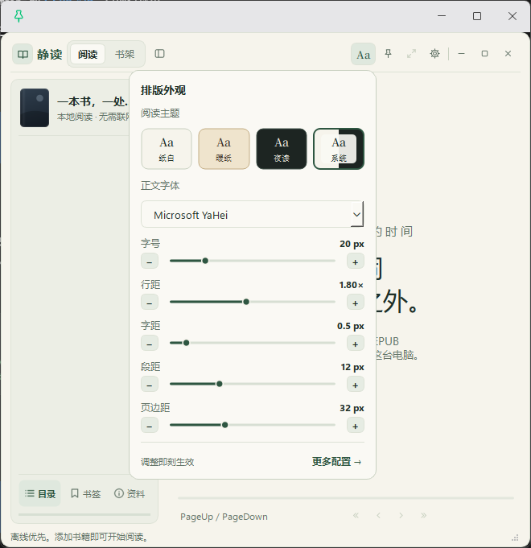
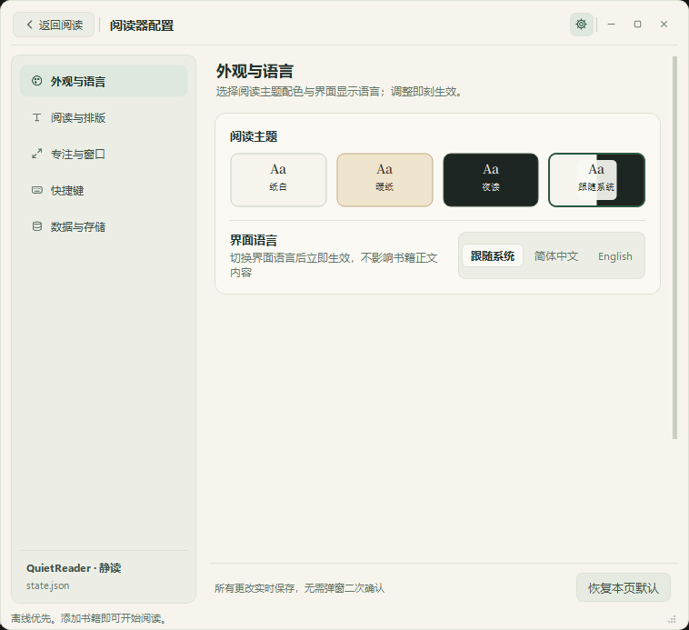
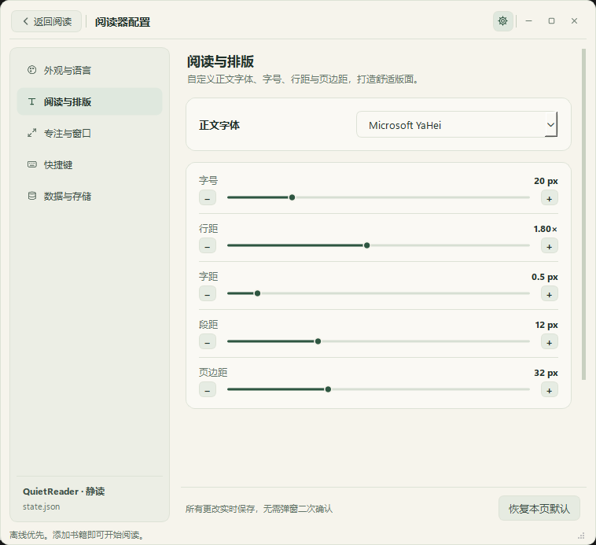
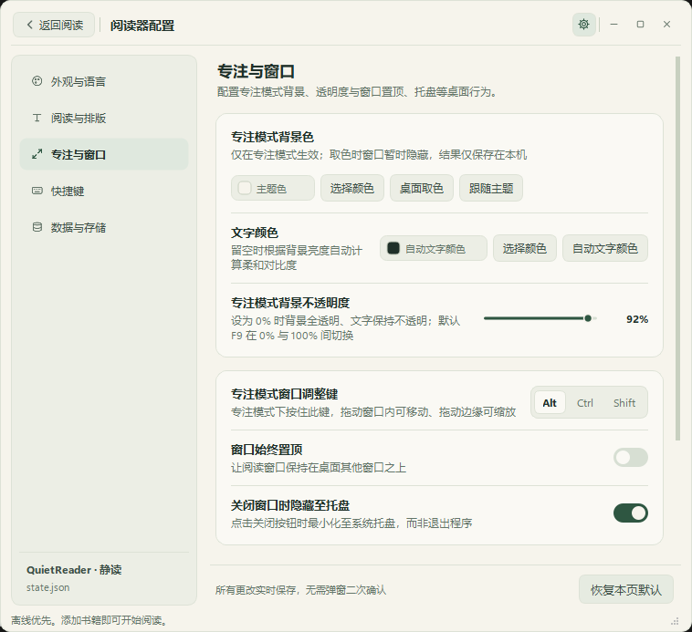
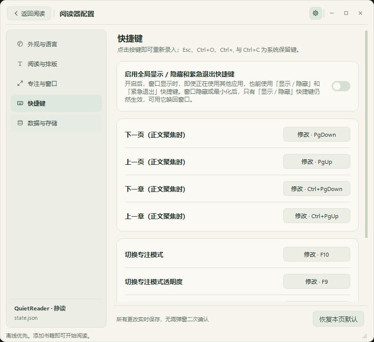

# QuietReader · 静读 — A Lazy Library

[简体中文](README.md) · [English](README.en.md)

<p align="center"></p>

QuietReader is an offline-first desktop reader for Windows, built with Python and PySide6. It reads local TXT, EPUB, and PDF books and includes a bookshelf, navigation, bookmarks, live layout controls, and a distraction-free Focus mode. Books and reading progress stay on your computer.

## Screenshots

### Reading



Press `Ctrl+O` to choose a local TXT, EPUB, or PDF file, or drag a file into the window. After importing, open the book from the bookshelf.


Use the sidebar to switch between contents, bookmarks, and book info. Click the sidebar button in the top bar to collapse it. The progress bar at the bottom lets you seek within the current chapter. Whole-book progress appears to the right of the page controls. Reopening a book restores your last reading position.

### Focus mode

| Blend with the background | Hold `Alt` to adjust the window |
| --- | --- |
|  |  |

Use the desktop color picker under **Configuration → Focus & window** to sample a background color. You can also set the background opacity and text color there. Press `F10` to enter Focus mode and hide the reader controls. Hold the default adjustment key, `Alt`, to drag the window or resize it from an edge. Release the key to hide the outline, or press `Esc` to return to the regular reading view.



The Focus popover can automatically sample the color around the window and shows the sampled color and trigger mode. For complex backgrounds, set an opacity cap. Slider values update during dragging, while the reading page updates once after release.

### Bookshelf


Use the left pane to browse recently read books, all books, or a category. Search by title or author, sort by last read, title, or reading progress, and switch between the cover grid and list views. Import books with **Add books** or by dragging local files into the window. Drag selected books onto a category to move them, or use a book's **···** menu to change its displayed title.

### Appearance and layout



Click `Aa` in the reading toolbar to change the theme, font, font size, line height, letter spacing, paragraph spacing, or page padding. Changes take effect immediately. Select **More settings** to open the full configuration page.

### Configuration

Click the gear or press `Ctrl+,` to open Configuration. Use the left pane to switch between sections. Changes are saved automatically. **Data & storage** shows the current data directory and state file path.

<details>
<summary>Show configuration screenshots</summary>

#### Appearance & language



Choose a reading theme and use the system language, Simplified Chinese, or English for the interface.

#### Reading & layout



Select a font and use the sliders or the plus and minus buttons to fine-tune text size, spacing, and page padding.

#### Focus & window



Set the Focus mode background and text colors, background opacity, and window adjustment key. This page also includes always-on-top and close-to-tray settings.

#### Shortcuts



Click a binding to record a new shortcut. With global shortcuts enabled, you can show or hide QuietReader while another app is active. Emergency exit is also available globally while the reader window is visible.

</details>

## Features

- **TXT reading** with automatic detection for common encodings and manual encoding selection when text looks garbled.
- **EPUB reading** for common EPUB 2/3 reflowable books, including navigation, internal links, page lists, covers, metadata, text formatting, and embedded illustrations.
- **PDF reading** that reflows extractable text and renders pages without extractable text as images for scanned PDFs.
- **Local bookshelf** with recent books, all books, and custom categories. Adding a book copies it into the QuietReader library; moving it to a category moves that managed copy and leaves the original file untouched.
- **Reading tools** including a table of contents, bookmarks and notes, book information, saved positions, and a collapsible sidebar.
- **Live typography controls** for font size, font family, line height, letter spacing, paragraph spacing, and page padding.
- **Themes and languages** with system, paper, sepia, and night themes, plus Simplified Chinese, English, or the system language.
- **Focus mode** hides reader controls and shows the book text, with configurable background opacity, desktop color sampling, text color, and always-on-top behavior. Hold the adjustment key to move or resize the window; only a fully transparent background is temporarily raised to 1% for mouse input, while other opacity levels remain unchanged.
- **Keyboard controls** for paging, chapter navigation, Focus mode, window visibility, and emergency exit. Hold the configured adjustment key to move or resize the window in Focus mode.
- **Offline by design**: no account or online book source is required; books, positions, and preferences stay local.

## Keyboard shortcuts

These are the defaults. Shortcuts can be changed in Configuration, except for a small set reserved for application actions.

| Action | Default |
| --- | --- |
| Next / previous page | `PageDown` / `PageUp` |
| Next / previous chapter | `Ctrl+PageDown` / `Ctrl+PageUp` |
| Toggle Focus mode / exit Focus mode | `F10` / `Esc` |
| Toggle Focus mode opacity (0% / 100%) | `F9` |
| Add books / Configuration | `Ctrl+O` / `Ctrl+,` |
| Show / hide the window | `Ctrl+Alt+R` |
| Emergency exit | `Ctrl+Alt+Q` |

Enable global shortcuts under Configuration → Shortcuts. While the window is visible, Show / Hide and Emergency Exit work even when another app is active. When the window is hidden or minimized, only Show / Hide remains active so you can bring the window back. The default Focus mode window adjustment key is `Alt`.

## Download and run

**Download the latest release:** [Open the latest GitHub Release](https://github.com/Nore07/Quiet-Reader/releases/latest) to choose the Windows x64 portable ZIP or installer; matching SHA-256 checksum files are listed on the same page. This link follows the latest published release, so the README does not need a version number update. The archive does not include personal settings or books. After extraction, run `QuietReader.exe`; it creates a `data\` folder beside the executable. Keep all files in the extracted directory while running the app.

**Use the installer**

Run `QuietReader-Setup-<version>-x64.exe` and follow the wizard. Setup defaults to `%LOCALAPPDATA%\Programs\QuietReader` for the current user, requires no administrator privileges, and offers an optional desktop shortcut.

- **Upgrade in place.** Exit QuietReader, then run the newer installer. If Setup detects an existing installation, it displays the upgrade destination and reuses that directory, keeping the books, bookmarks, reading progress, and settings in `data`.
- **Change the installation directory.** Back up the entire `data` folder from the old directory, uninstall the old version through Windows **Installed apps**, then install to the new directory. Clear **Launch QuietReader** on the final page, copy the backed-up `data` folder beside the new `QuietReader.exe`, and then open the reader. If you use `--data-dir`, keep that custom directory as well.
- **Switch from the portable build.** If QuietReader is not already installed, select the folder containing the portable `QuietReader.exe` in the wizard to keep using that folder's `data`.

**Run from source:** Download or clone this repository. Python 3.12 or newer is required. From the repository root in PowerShell:

```powershell
py -3.12 -m venv .venv
.\.venv\Scripts\python.exe -m pip install -r requirements.txt
.\.venv\Scripts\python.exe run.py
```

To open a local book directly:

```powershell
.\.venv\Scripts\python.exe run.py "D:\Books\sample.epub"
```

## Formats and local data

QuietReader supports common TXT, unencrypted reflowable EPUB, and PDF files up to 64 MiB and 4,096 pages. Password-protected PDFs and files the bundled Qt PDF engine cannot read are unsupported. Each PDF page is extracted as text or rendered as an image; scanned pages are not OCR-processed.

Preferences and books are stored in a `data` folder under the reader root. For source runs, this is `data\` under the repository root. For a release, it is `data\` beside `QuietReader.exe`. Configuration, reading positions, and bookmarks are in `data\state.json`; imported book copies are under `data\bookshelf\uncategorized\` or `data\bookshelf\<category>\`. The on-disk names `bookshelf` and `uncategorized` are English; the interface still translates the labels according to the selected language.

The source version and release use their own root-level `data` folders and do not synchronize by default. To share data between them, pass the same `--data-dir <directory>` to both. On first use of the default path, if the target `data` folder is empty, data from the previous `%LOCALAPPDATA%\QuietReader\QuietReader\` location is copied there; the old directory is retained. Keep the release's `data` folder when updating. If you extract a release to a new directory, copy the old `data` folder alongside the new `QuietReader.exe`.

When a copied `data` folder is used from a new application directory, startup checks whether saved bookshelf records still point to the previous location. If the matching book files exist under the new `data\bookshelf`, QuietReader updates their paths and IDs while retaining reading progress, bookmarks, and recent-reading state. Back up `data` before relocating it. Records are left unchanged when a matching file cannot be found; the old data is not deleted.

## Contributing

Report bugs and suggest improvements through [GitHub Issues](https://github.com/Nore07/Quiet-Reader/issues). See the [contribution guide](CONTRIBUTING.md) for branch, commit, and pull request workflow.

## License

QuietReader source code is licensed under the [Apache License 2.0](LICENSE) (SPDX: `Apache-2.0`). See [`docs/third-party.md`](docs/third-party.md) for third-party dependency and distribution notes.
