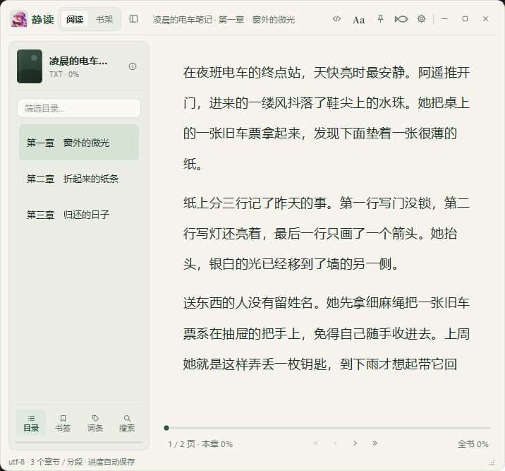
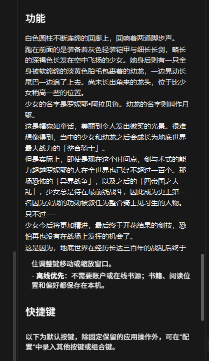
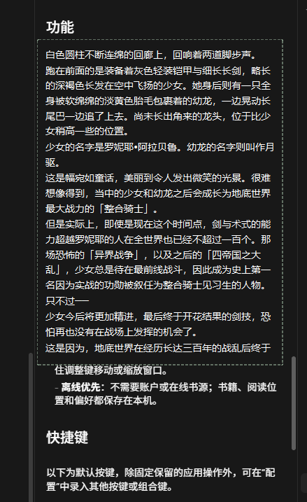
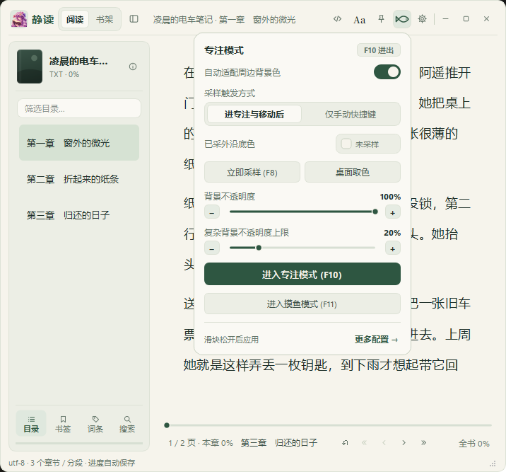
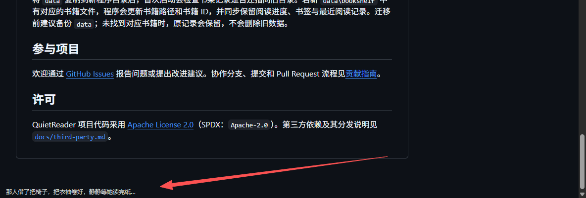
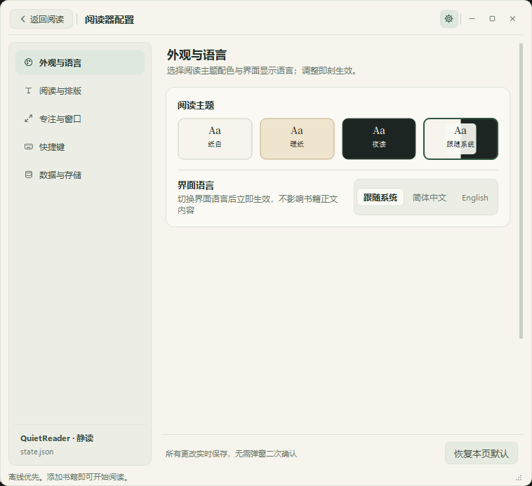

# QuietReader · 静读 —— 偷懒的大图书馆

[简体中文](README.md) · [English](README.en.md)

<p align="center"></p>

QuietReader 是一款面向 Windows 的离线本地阅读器，使用 Python 与 PySide6 构建。它支持 TXT、EPUB 和 PDF，提供书架、目录、书签、词条标注、全书搜索、排版调节、专注模式和摸鱼模式；书籍与阅读进度保存在本机。

## 界面预览

### 阅读


按 `Ctrl+O` 选择本地 TXT、EPUB 或 PDF，也可把文件拖入窗口。导入后，可以在书架打开书籍。



在左侧切换目录、书签和资料，点击上方的侧栏按钮可收起侧栏。底部进度条用于在当前章节内定位，翻页区右侧单独显示全书进度。重新打开书籍时会恢复上次的阅读位置。

### 词条标注


选中正文中的词语并右键选择「添加词条标注」，填写备注；也可打开左侧「词条」页并点击「添加」。正文中匹配到的词语会显示标记，鼠标移到标记上即可查看备注。在词条列表中可以筛选、编辑或删除标注，双击词条可在全书搜索，也可以从其他书籍继承词条。

### 全书搜索


打开左侧「搜索」页并输入关键词，QuietReader 会搜索整本书并列出带上下文的结果片段。使用输入框旁的箭头或按 `Enter` / `Shift+Enter` 浏览匹配项；点击结果片段可跳到正文对应位置，当前匹配会高亮显示。

### 专注模式

| 融入背景 | 按住 `Alt` 调整窗口 |
| --- | --- |
|  |  |

在「配置 → 专注与窗口」使用「桌面取色」采样背景，也可自行设置背景不透明度和文字颜色。按 `F10` 进入专注模式后，阅读控件会隐藏。按住默认调整键 `Alt` 可拖动窗口或拖动边缘缩放，松开后窗口轮廓消失。按 `Esc` 返回普通阅读界面。



专注浮层可自动采样窗口外沿颜色，并显示采样结果与触发方式。「桌面取色」可从屏幕点选颜色；按 `F8` 可立即重新采样。开启自动适配后，可选择进入专注模式或移动窗口后采样，也可只用快捷键手动采样。复杂背景可限制不透明度上限；拖动滑块时数值会更新，松开鼠标后才应用到阅读页面，避免拖动过程中反复重排。

### 摸鱼模式



先打开一本书，再点击阅读页顶部的鱼形按钮，在浮层中选择「进入摸鱼模式」；也可按默认快捷键 `F11` 切换。摸鱼模式把正文收成一行阅读条，默认鼠标靠近时显示、移开后自动隐藏。滚轮或 `PageDown` / `PageUp` 可逐句翻页；按住窗口调整键（默认为 `Alt`）拖动阅读条，可将它移到 IDE 状态栏附近。按 `F7` 可切换单行或两行显示；右键阅读条打开菜单，可翻上一句或下一句、切换行数或退出模式，再按 `F11` 也可退出。相关快捷键可在「配置 → 快捷键」中修改。

### 书架


在左侧查看最近阅读、所有书籍或指定分类。上方可按书名或作者搜索，按最近阅读、书名或阅读进度排序，并切换封面网格与列表视图。用「添加书籍」或拖入本地文件导入书籍。选中书籍后，可将它们拖到左侧分类，也可用书卡的「···」菜单修改显示书名。

### 排版外观


点击阅读页顶部的 `Aa`，即可切换纸白、暖纸、夜读或跟随系统的主题，调整正文字体、字号、行距、字距、段距和页边距。更改立即生效，点击「更多配置」可打开完整配置页。

### 阅读器配置

点击齿轮或按 `Ctrl+,` 打开配置。左侧切换配置分类，更改会自动保存。「数据与存储」可查看当前数据目录和配置文件路径。

<details>
<summary>展开配置截图</summary>

#### 外观与语言



选择阅读主题和界面语言。界面语言可跟随系统，也可选简体中文或 English。

#### 阅读与排版


选择正文字体，用滑块或两侧的加减按钮微调字号、间距和页边距。

#### 专注与窗口


设置专注模式的背景色、文字色和背景不透明度，并配置窗口调整键、置顶与关闭窗口时隐藏到系统托盘。

#### 快捷键


点击对应的按键重新录入快捷键。开启全局快捷键后，可在使用其他应用时显示或隐藏阅读窗口。阅读窗口可见时，紧急退出键也可全局触发。

</details>

## 功能

- **TXT 阅读**：自动识别常见编码，遇到乱码时可手动选择编码。
- **EPUB 阅读**：支持常见的 EPUB 2/3 重排版书籍、目录导航、书内链接、页码列表、封面、元数据、文字格式和内嵌插图。
- **PDF 阅读**：逐页提取可读取的文字并按正文排版；没有可读取文字的页面会渲染为图像，适合扫描版 PDF。
- **本地书架**：最近阅读、全部书籍与自建分类。添加书籍会复制到 QuietReader 的书架目录，分类时会移动书架内的副本，原始文件不受影响。
- **阅读辅助**：目录、书签与笔记、词条标注、全书搜索、书籍资料、阅读位置恢复、可折叠侧栏。
- **实时排版**：字号、字体、行距、字距、段距和页边距可在阅读界面中即时预览。
- **外观和语言**：系统、纸白、暖纸、夜读主题；支持简体中文、English 或跟随系统语言。
- **专注模式**：隐藏阅读界面控件，只保留书中文字；支持背景透明度、桌面取色、文字颜色与窗口置顶。按住调整键可移动或缩放窗口；只有背景为 0% 时才临时提高到 1% 以接收鼠标操作，已有的非零透明度保持不变。
- **摸鱼模式**：将正文缩成可自动显隐的阅读条，支持逐句翻页、单行/两行切换和快捷键操作。
- **键盘操作**：翻页、切换章节、进入专注模式、摸鱼模式、显示/隐藏窗口和紧急退出等按键均可配置。专注模式中可按住调整键移动或缩放窗口。
- **离线优先**：不需要账户或在线书源；书籍、阅读位置和偏好都保存在本机。

## 快捷键

以下为默认按键，除固定保留的应用操作外，可在“配置”中录入其他按键或组合键。

| 操作 | 默认快捷键 |
| --- | --- |
| 下一页 / 上一页（摸鱼模式中逐句翻页） | `PageDown` / `PageUp` |
| 下一章 / 上一章 | `Ctrl+PageDown` / `Ctrl+PageUp` |
| 切换专注模式 / 退出专注模式 | `F10` / `Esc` |
| 重新采样专注模式背景色 | `F8` |
| 专注模式透明度切换（0% / 100%） | `F9` |
| 切换摸鱼模式 / 单行两行显示 | `F11` / `F7` |
| 添加书籍 / 配置 | `Ctrl+O` / `Ctrl+,` |
| 显示 / 隐藏窗口 | `Ctrl+Alt+R` |
| 紧急退出 | `Ctrl+Alt+Q` |

在「配置 → 快捷键」开启全局快捷键后，只要窗口仍显示，即使正在使用其他应用，也能触发显示/隐藏或紧急退出。窗口隐藏或最小化后，只有显示/隐藏快捷键仍然生效，可用它唤回窗口。专注模式的窗口调整键默认为 `Alt`；摸鱼模式开启时，其模式和翻句快捷键在阅读条自动隐藏后仍可使用。

## 获取与运行

**下载最新软件包：** [打开 GitHub 最新正式版页面](https://github.com/Nore07/Quiet-Reader/releases/latest)，选择 Windows x64 便携版 ZIP 或安装程序；对应的 SHA-256 校验文件也在同一页面。链接会自动指向最新正式版，不必随版本更新 README。压缩包不包含个人配置或书籍；解压后运行 `QuietReader.exe`，程序会在其旁边创建 `data\`。运行时请保留解压目录中的全部文件。

**使用安装包**

运行 `QuietReader-Setup-<版本>-x64.exe`，按向导完成安装。默认安装到当前用户的 `%LOCALAPPDATA%\Programs\QuietReader`，无需管理员权限，可选创建桌面快捷方式。

- **原地升级**。先退出正在运行的 QuietReader，再运行新版安装包。检测到旧版安装时，向导会显示本次升级的目标目录，并沿用原目录，保留 `data` 中的书籍、书签、阅读进度和配置。
- **更换安装目录**。先备份旧目录的整个 `data` 文件夹，通过 Windows 的「已安装的应用」卸载旧版，再安装到新目录。在完成页取消勾选「启动 QuietReader」，把备份的 `data` 复制到新 `QuietReader.exe` 旁边，再打开阅读器。如果用过 `--data-dir`，也请保留该自定义目录。
- **从便携版转为安装版**。如果尚未安装 QuietReader，可在向导里选择原便携版的 `QuietReader.exe` 所在目录，沿用该目录的 `data`。

**从源码运行：** 下载或克隆仓库后，需要 Python 3.12 或更新版本。在仓库根目录运行 PowerShell 命令：

```powershell
py -3.12 -m venv .venv
.\.venv\Scripts\python.exe -m pip install -r requirements.txt
.\.venv\Scripts\python.exe run.py
```

也可直接打开一本本地书籍：

```powershell
.\.venv\Scripts\python.exe run.py "D:\Books\sample.epub"
```

## 格式与数据

目前支持常见 TXT、未加密且可重排的 EPUB，以及不超过 64 MiB、4096 页的 PDF。密码保护或当前 Qt PDF 引擎无法读取的 PDF 不在支持范围内；扫描页不会进行 OCR。

配置和书籍都保存在阅读器根目录下的 `data` 文件夹中：源码运行时位于仓库根目录的 `data\`，Releases 版位于 `QuietReader.exe` 所在目录的 `data\`。配置、阅读进度和书签保存在 `data\state.json`；导入的书籍副本保存在 `data\bookshelf\uncategorized\` 或 `data\bookshelf\<分类名>\` 中。磁盘上的 `bookshelf` 和 `uncategorized` 使用英文名称，界面仍会根据语言设置显示“书架 / Bookshelf”和“未分类 / Uncategorized”。

源码版和 Releases 版分别使用各自根目录的 `data`，默认不会互相同步。若要共享数据，可给两种启动方式传入相同的 `--data-dir <目录>`。首次使用默认目录且目标 `data` 为空时，旧版 `%LOCALAPPDATA%\QuietReader\QuietReader\` 中的数据会复制过去，原目录会保留。更新 Releases 版时请保留原目录中的 `data`；若解压到新目录，请把旧目录的 `data` 一并复制过去。

将 `data` 复制到新程序目录后，首次启动会检查书架记录是否还指向旧目录。若新 `data\bookshelf` 中有对应的书籍文件，程序会更新书籍路径和书籍 ID，并同步保留阅读进度、书签与最近阅读记录。迁移前建议备份 `data`；未找到对应书籍时，原记录会保留，不会删除旧数据。

## 参与项目

欢迎通过 [GitHub Issues](https://github.com/Nore07/Quiet-Reader/issues) 报告问题或提出改进建议。协作分支、提交和 Pull Request 流程见[贡献指南](CONTRIBUTING.md)。

## 许可

QuietReader 项目代码采用 [Apache License 2.0](LICENSE)（SPDX：`Apache-2.0`）。第三方依赖及其分发说明见 [`docs/third-party.md`](docs/third-party.md)。
